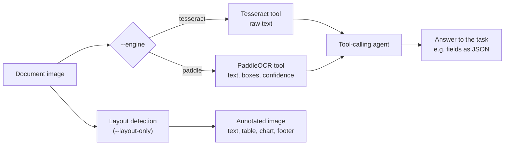

# Agentic Document Extraction

A LangChain agent that reads document images through OCR tools and completes extraction tasks given in plain language, such as "extract tax and total in JSON format" from an invoice. It pairs two generations of OCR: Tesseract, and PaddleOCR with deep-learning text detection and layout analysis.

## Highlights

- **The agent decides when to read.** Each OCR engine is wrapped as a LangChain tool. A tool-calling LLM agent calls it, reasons over the raw output and returns the answer, for example telling a subtotal from a total.
- **Two OCR engines, one interface.** Tesseract for clean printed text; PaddleOCR for text with bounding boxes and confidence scores.
- **Layout analysis.** PaddleOCR's layout model labels regions (text, table, chart, footer), to avoid the reading-order errors plain OCR makes on multi-column pages.
- **Inspectable output.** Text boxes and layout regions are drawn onto the image and saved, so every extraction can be checked by eye.
- **Testable core.** Bounding-box geometry and confidence filtering live in a pure module with no OCR dependency.

## How it works



## Project structure

```
src/
  ocr_tesseract.py   Tesseract OCR as a LangChain tool
  ocr_paddle.py      PaddleOCR text recognition and layout detection
  geometry.py        Polygon-to-box conversion, confidence filtering and sorting
  agent.py           The tool-calling agent (gpt-5-mini by default)
  visualize.py       Draws OCR boxes and layout regions, and saves the images
main.py              Command-line entry point
tests/               Unit tests for the geometry module
```

## Getting started

Requires Python 3.11 or 3.12, the Tesseract binary, and an OpenAI API key.

```bash
python -m venv venv
source venv/bin/activate          # Windows: venv\Scripts\activate
pip install -r requirements.txt
```

Install Tesseract with `brew install tesseract`, `apt-get install tesseract-ocr`, or the [Windows installer](https://github.com/UB-Mannheim/tesseract/wiki). Set `OPENAI_API_KEY` in a `.env` file or your shell.

## Usage

```bash
# Tesseract and the agent
python main.py --image invoice.png --task "extract tax and total in JSON format" --engine tesseract

# PaddleOCR and the agent
python main.py --image receipt.jpg --task "check whether the total is correct" --engine paddle

# Layout detection only, no LLM call: saves an annotated image
python main.py --image report.png --engine paddle --layout-only
```

Annotated images are saved to `outputs/`.

## Tests

```bash
pytest
```

The unit tests cover the bounding-box geometry and confidence filtering, which need no OCR engine or API key.

## Why two OCR engines

Tesseract is a classic OCR engine: fast and dependable on clean printed text, but it misreads numbers, garbles tables and struggles with handwriting. PaddleOCR uses deep-learning detection and recognition models, returns a position and confidence for every line, and adds layout analysis. Keeping both behind the same agent makes the difference easy to see on the same document.

## Roadmap

- Reading-order resolution for complex layouts
- Vision-language tools for charts and tables
- Schema-based field extraction with validation
- Retrieval over parsed documents (RAG)

## Acknowledgements

Builds on the first two labs of a LandingAI course on document AI, restructured into a modular, tested command-line tool.
